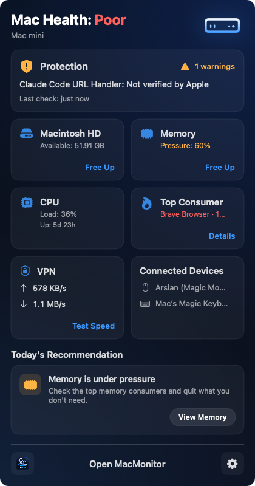
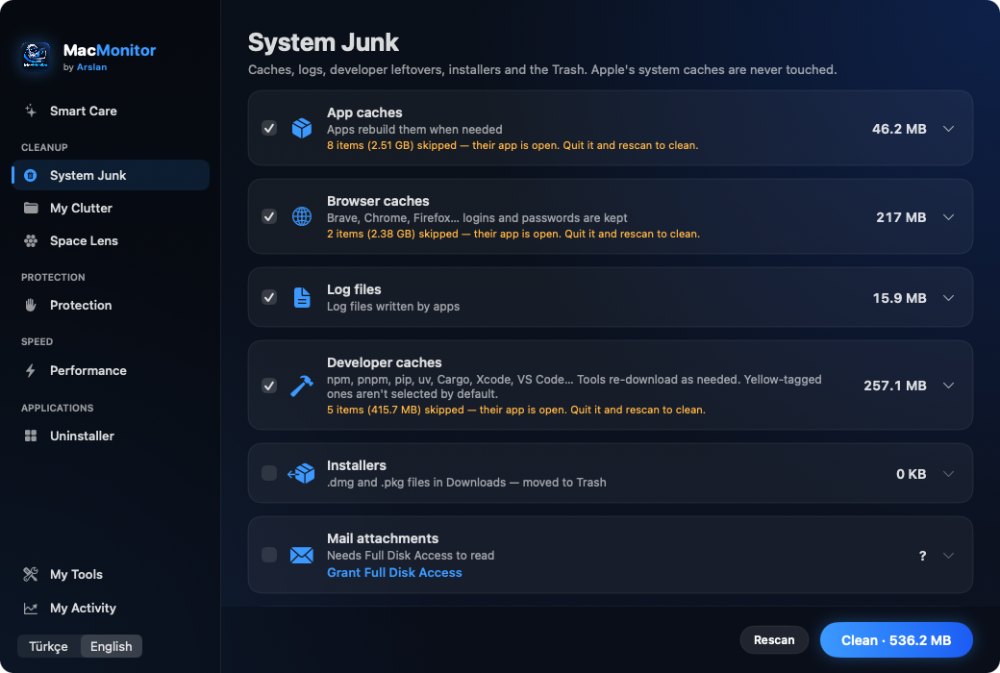
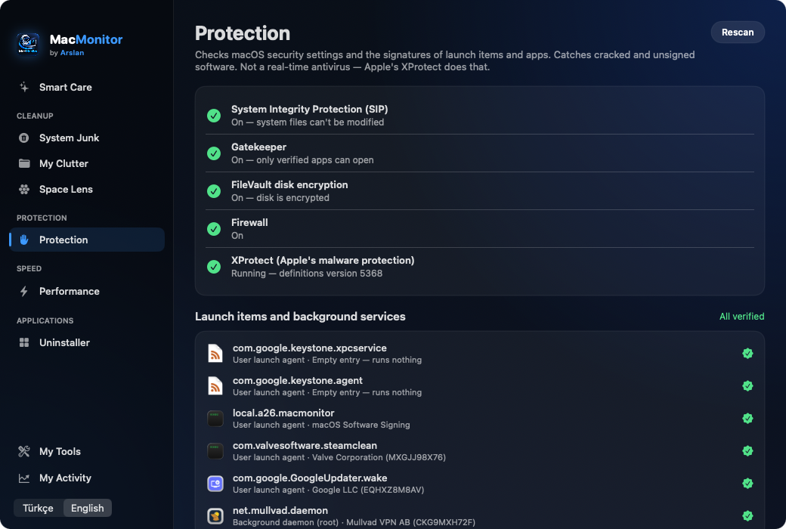
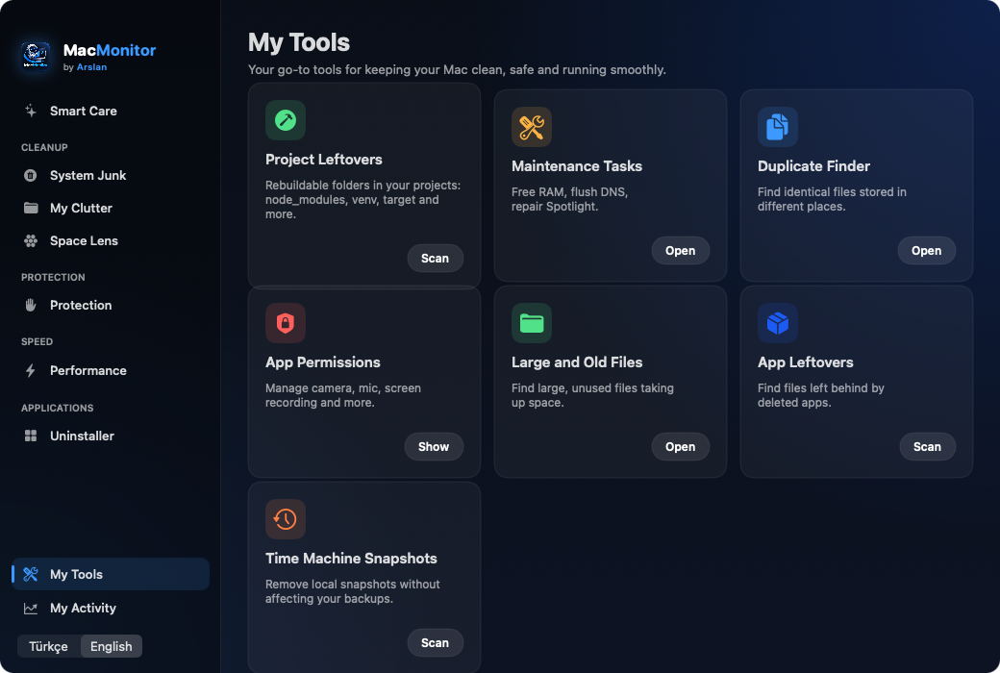
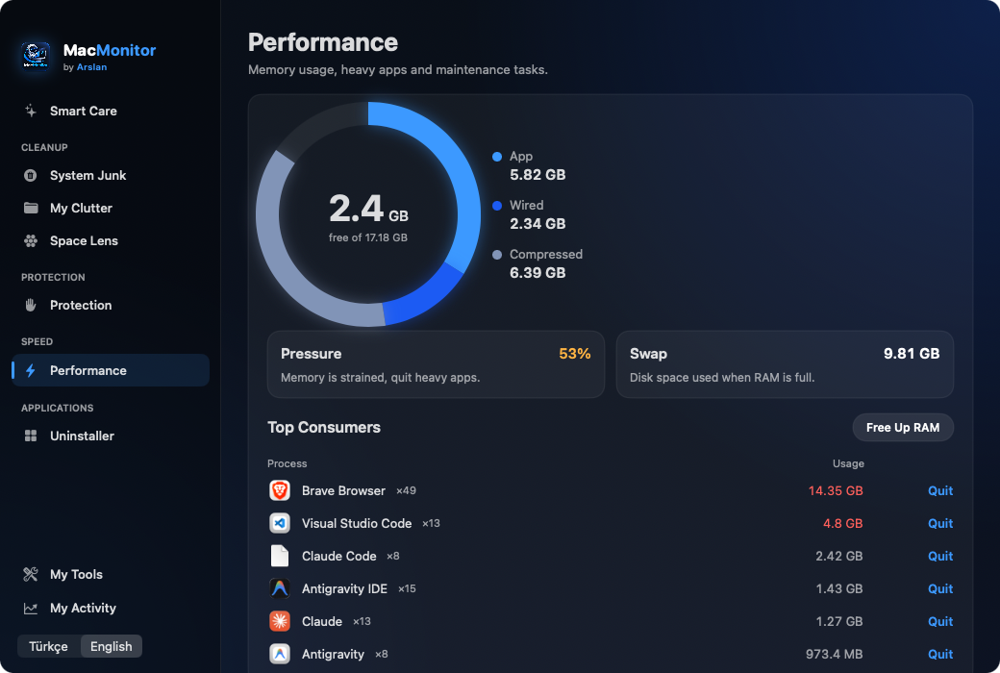
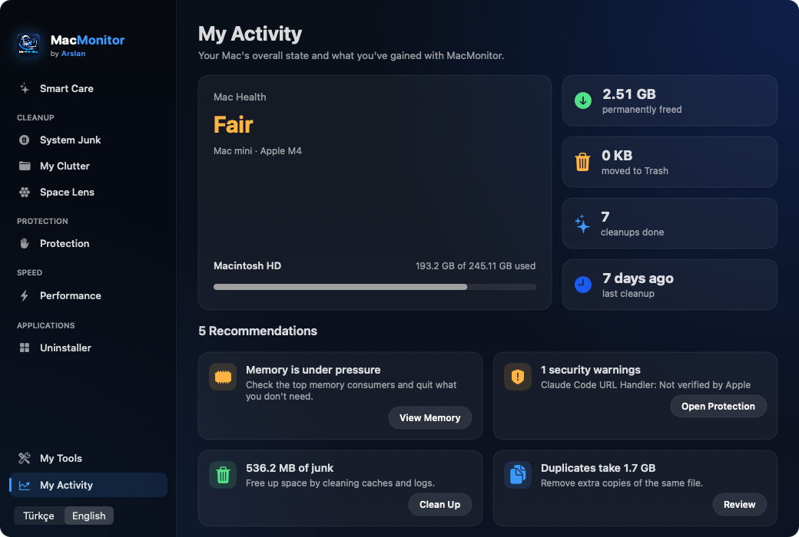

<p align="center">
  
</p>

<h1 align="center">MacMonitor</h1>

<p align="center">
  A lightweight, privacy-first Mac care app that lives in your menu bar.<br>
  <b>by Arslan</b>
</p>

<p align="center">
  
  
  
  
</p>

<p align="center">
  
</p>

---

## What's new in 2.4

- **Project Leftovers.** Finds rebuildable folders in old projects, such as `node_modules`, `venv`, Rust `target` and `.next`, and frees the space safely.
- **Safety check before every removal.** Every path is verified against a protected list before anything is moved or deleted.
- **Disk-full forecast.** Uses the last 90 days of disk usage to estimate when your disk will be full.

## Features

### Menu bar panel



- Mac health summary with live CPU, memory, disk and network stats
- Tap any card for details: disk breakdown and SMART status, CPU graph, memory ring, network graphs, speed test, battery on laptops
- Top memory and CPU consumers, with a **Quit** button that asks before closing
- Today's recommendation, Bluetooth devices and their battery levels
- Disk alerts at 80% and 90% full

<br clear="right">

### Main window

| Section | What it does |
|---|---|
| **Smart Care** | One scan that summarizes cleanup, protection, performance, apps and clutter |
| **System Junk** | App and browser caches, logs, 50+ developer caches (npm, pnpm, pip, uv, Cargo, Gradle, Xcode, VS Code…) with risk labels and explanations, installers, Mail attachments and the Trash. Each item can be selected on its own |
| **My Clutter** | Files over 100 MB that haven't been opened in 6 months, and exact duplicate files |
| **Space Lens** | Shows folders by size, and you can click into them to explore |
| **Protection** | SIP, Gatekeeper, FileVault, Firewall and XProtect status, plus signature checks for launch items and apps that catch cracked or unsigned software |
| **Performance** | Memory details, free up RAM, flush DNS cache, repair Spotlight |
| **Uninstaller** | Removes an app together with its leftovers in Library |
| **My Tools** | **Project Leftovers**, app leftovers, Time Machine local snapshots, app permissions |
| **My Activity** | Space freed permanently and space moved to the Trash, disk-full forecast and recommendations |

Turkish and English interface, launch at login. When the panel is closed, MacMonitor only measures the values shown in the menu bar, at about 0.5% CPU.

### Screenshots

<table>
  <tr>
    <td><br><sub><b>System Junk</b> with developer caches and risk labels</sub></td>
    <td><br><sub><b>Protection</b> with security settings and signature checks</sub></td>
  </tr>
  <tr>
    <td><br><sub><b>My Tools</b> including Project Leftovers</sub></td>
    <td><br><sub><b>Performance</b> with memory breakdown and top consumers</sub></td>
  </tr>
  <tr>
    <td colspan="2" align="center"><br><sub><b>My Activity</b> with stats and recommendations</sub></td>
  </tr>
</table>

## Safety and privacy

MacMonitor works as carefully as a cleaning app should:

- **It sends no data to the internet.** No telemetry, no analytics, no account. The only network connection is the measurement made by macOS's own `networkQuality` tool against Apple servers when you press **Test Speed**.
- **It installs no root helper.** Nothing runs in the background with full privileges. The admin password is only requested for maintenance tasks, through the standard macOS prompt.
- **It never touches credentials.** Keychain, `Application Support`, `~/.ssh`, shell history and `~/.claude` are outside the cleanup scope.
- **User files go to the Trash, not straight to deletion.** Large files, duplicates, installers and app leftovers can always be restored.
- **Every removal passes a safety check.** Symlinks, home folders, `.ssh`, `.claude`, Keychain, Mail, Messages, iCloud, photo libraries, `.env` files and `.git` are refused. A folder inside a Git repository is only cleaned if it is listed in `.gitignore`, so source code is never touched.
- **Project Leftovers is cautious by default.** Projects with a running program, such as a bot or a server, are skipped. Only projects untouched for more than 30 days are selected, and Python environments are not selected.
- **Extra safeguards.** Caches of open apps are skipped. Apple's system caches and caches with user data, such as Spotify offline music, are protected. Folders containing files like `auth`, `token`, `session` or `login` are never shown as leftovers.
- **It is not a real-time antivirus.** The Protection section checks settings and signatures. For malware signature scanning, rely on Apple's XProtect or a tool such as Malwarebytes.

## Installation

### Download the .dmg
1. Download `MacMonitor-x.y.dmg` from the [Releases](../../releases) page.
2. Open it and drag **MacMonitor** into **Applications**.
3. On first launch macOS shows a warning, because the app is not registered with a paid Apple Developer account. Go to **System Settings › Privacy & Security › Open Anyway**. You only need to do this once.

Requirements: macOS 13 Ventura or later, Apple Silicon or Intel.

### Build from source
```bash
xcode-select --install          # once: Apple command line tools
git clone https://github.com/arslanilyasovich/MacMonitor.git
cd MacMonitor
./build.sh                      # builds, signs, installs to /Applications and launches
tools/make_dmg.sh               # optional: creates a .dmg in dist/
```
On its first run, `build.sh` creates a local code-signing certificate unique to your Mac. It stays in your Keychain and is never sent anywhere. This way macOS doesn't ask for permissions again after every build.

## Project structure
```
Sources/      SwiftUI app (models and views)
tools/        icon, .dmg and signing certificate scripts
assets/       logo
docs/         README images
build.sh      build + install
```

---

## Türkçe

MacMonitor, menü çubuğunda yaşayan hafif ve güvenli bir Mac bakım uygulamasıdır. Anlık CPU, bellek, disk ve ağ durumu, 50'den fazla geliştirici önbelleğiyle çöp temizliği, proje artıkları, disk dolma tahmini, büyük ve kopya dosya bulucu, Alan Haritası, artıklarıyla uygulama kaldırma ve güvenlik kontrolü sunar. Arayüz Türkçe ve İngilizcedir.

**Gizlilik:** Telemetri, hesap ve root servisi yoktur. Anahtar Zinciri, SSH anahtarları ve terminal geçmişine dokunulmaz. Kullanıcı dosyaları silinmez, Çöp Kutusu'na taşınır.

**Kurulum:** Releases sayfasından `.dmg` dosyasını indir ve Uygulamalar klasörüne sürükle. İlk açılışta **Sistem Ayarları › Gizlilik ve Güvenlik › Yine de Aç** yolunu izle.

---

## License

© 2026 Arslan. **All rights reserved.** The source code is visible for review only. It may not be copied, modified, redistributed, sold or published under another name without permission. See [LICENSE](LICENSE) for details.

<p align="center"><sub>Made by <b>Arslan</b></sub></p>
