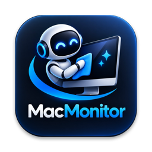
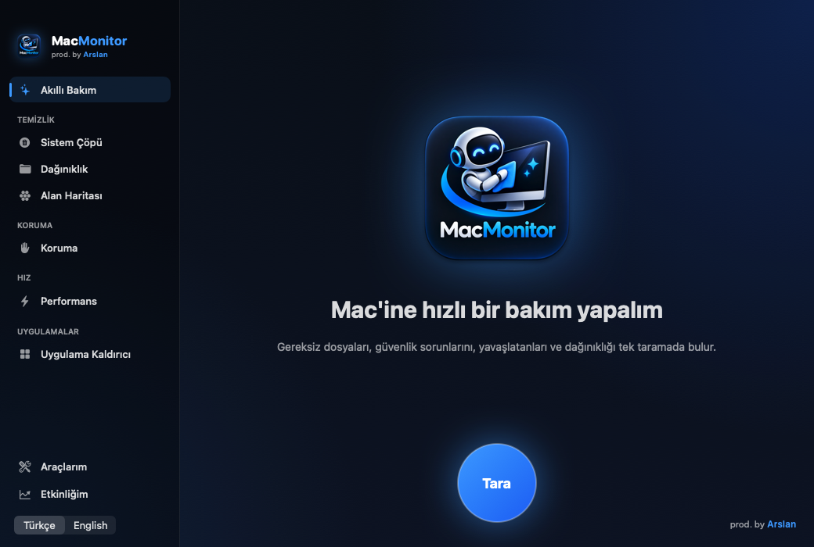

<p align="center">
  
</p>

<h1 align="center">MacMonitor</h1>

<p align="center">
  Menü çubuğunda yaşayan, hafif ve güvenli bir Mac bakım uygulaması.<br>
  <i>A lightweight, privacy-first Mac care app that lives in your menu bar.</i><br><br>
  <b>prod. by Arslan</b>
</p>

<p align="center">
  
</p>

---

## Özellikler

**Menü çubuğu paneli**
- Mac sağlığı özeti, CPU / RAM / disk / ağ anlık durumu
- Her karta tıklayınca ayrıntı: disk dağılımı ve SMART durumu, CPU grafiği, bellek halkası, ağ grafikleri, hız testi, pil (dizüstülerde)
- En çok RAM ve CPU kullanan uygulamalar, onaylı **Kapat** düğmesi
- Bugünün önerisi, Bluetooth cihazları ve pil seviyeleri

**Ana pencere**
| Bölüm | Ne yapar |
|---|---|
| Akıllı Bakım | Tek taramada temizlik, koruma, performans, uygulamalar ve dağınıklık özeti |
| Sistem Çöpü | Uygulama ve tarayıcı önbellekleri, günlükler, geliştirici önbellekleri, kurulum dosyaları, Mail ekleri, Çöp Kutusu |
| Dağınıklık | 100 MB üstü ve 6 aydır açılmamış dosyalar, birebir aynı (kopya) dosyalar |
| Alan Haritası | Klasörleri boyuta göre gösterir, içine girerek gezinilir |
| Koruma | SIP, Gatekeeper, FileVault, Güvenlik Duvarı, XProtect; başlangıç öğeleri ve uygulamaların imza kontrolü (kırık/imzasız yazılımları yakalar) |
| Performans | Bellek ayrıntısı, RAM boşaltma, DNS önbelleği, Spotlight onarımı |
| Uygulama Kaldırıcı | Uygulamayı Kitaplık'taki artıklarıyla birlikte kaldırır |
| Araçlarım | Uygulama artıkları, Time Machine yerel anlık görüntüleri, uygulama izinleri |
| Etkinliğim | Toplam açılan yer ve öneriler |

Türkçe ve İngilizce arayüz, açılışta otomatik başlatma.

## Güvenlik ve gizlilik

MacMonitor bir temizlik uygulamasından beklenmesi gereken en temkinli şekilde çalışır:

- **İnternete veri göndermez.** Telemetri, analitik, hesap yok. Tek ağ bağlantısı, sen **Hız Testi**'ne bastığında macOS'un kendi `networkQuality` aracının Apple sunucularına yaptığı ölçümdür.
- **Root servisi kurmaz.** Arka planda tam yetkiyle çalışan hiçbir şey yoktur. Yönetici şifresi sadece bakım görevlerinde, macOS'un kendi penceresiyle istenir.
- **Giriş bilgilerine dokunmaz.** Anahtar Zinciri, `Application Support`, `~/.ssh`, terminal geçmişi, `~/.claude` gibi alanlar temizlik kapsamında değildir.
- **Kullanıcı dosyaları silinmez, Çöp Kutusu'na taşınır.** Büyük dosyalar, kopyalar, kurulum dosyaları, uygulama artıkları geri alınabilir.
- **Ek korumalar:** açık uygulamaların önbelleği atlanır; Apple'ın sistem önbellekleri, Spotify çevrimdışı müzikleri gibi kullanıcı verisi içeren önbellekler korunur; içinde `auth`, `token`, `session`, `login` gibi dosyalar olan klasörler asla "artık" olarak gösterilmez.
- **Gerçek zamanlı antivirüs değildir.** Koruma bölümü ayarları ve imzaları denetler; virüs imzası taraması için Apple'ın XProtect'i ya da Malwarebytes gibi bir araç kullan.

## Kurulum

### Hazır kurulum dosyası (.dmg)
1. [Releases](../../releases) sayfasından `MacMonitor-x.y.dmg` dosyasını indir.
2. Aç ve **MacMonitor** simgesini **Uygulamalar** klasörüne sürükle.
3. İlk açılışta macOS uyarı verir (uygulama Apple'a ücretli geliştirici hesabıyla kayıtlı değildir):
   **Sistem Ayarları › Gizlilik ve Güvenlik › Yine de Aç**. Bir kez yeterlidir.

Gereksinim: macOS 13 Ventura veya üstü · Apple Silicon ve Intel.

### Kaynaktan derleme
```bash
xcode-select --install          # bir kez: Apple komut satırı araçları
git clone https://github.com/arslanilyasovich/MacMonitor.git
cd MacMonitor
./build.sh                      # derler, imzalar, /Applications'a kurar ve açar
tools/make_dmg.sh               # isteğe bağlı: dist/ içine .dmg üretir
```
`build.sh` ilk çalıştırmada bu Mac'e özel, yerel bir kod imzalama sertifikası oluşturur (anahtar zincirinde kalır, hiçbir yere gönderilmez). Böylece macOS izinleri her derlemede yeniden sorulmaz.

## Proje yapısı
```
Sources/      SwiftUI uygulaması (modeller ve ekranlar)
tools/        ikon, .dmg ve imza sertifikası betikleri
assets/       logo
build.sh      derleme + kurulum
```

---

## English

MacMonitor is a menu-bar Mac care app: live CPU / memory / disk / network stats, junk cleanup, large and duplicate file finder, Space Lens, uninstaller with leftovers, security check (catches cracked/unsigned software), maintenance tasks and Time Machine snapshot cleanup. Turkish and English UI.

**Privacy:** no telemetry, no accounts, no root helper. It never touches your Keychain, `Application Support`, SSH keys or shell history. User files are moved to the Trash, never deleted outright.

**Install:** download the `.dmg` from Releases, drag to Applications, then on first launch go to *System Settings › Privacy & Security › Open Anyway*. Or build from source with `./build.sh` (needs `xcode-select --install`).

---

## Lisans

© 2026 Arslan. **Tüm hakları saklıdır.** Kaynak kod incelenmek için görünürdür; izin alınmadan kopyalanamaz, değiştirilip dağıtılamaz, satılamaz veya başka bir isimle yayınlanamaz. Ayrıntılar: [LICENSE](LICENSE).

<p align="center"><sub>prod. by <b>Arslan</b></sub></p>
